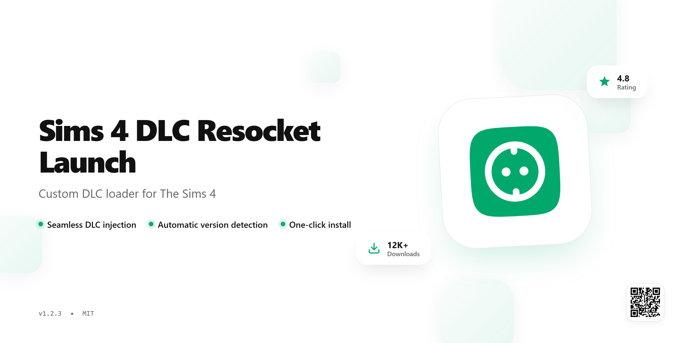

# Sims 4 DLC Launch: Your Mod Loadout Manager for Windows 🧩

### 📦 PowerShell Install Button

   

---

Sims 4 DLC Launch is a lightweight desktop companion that puts your entire mod collection under one roof, letting you sort, toggle, and profile your content without ever touching a `.package` file by hand. Think of it as a control room for your game: group mods into playstyle profiles, flip whole sets on or off in a single sweep, and spot troublemakers before they ever reach your loading screen. Everything stays safely outside your actual game installation, so your saves and base files remain untouched. Built for tinkerers and casual players alike, it turns mod wrangling into a few satisfying clicks.

## 🔧 Requirements

- **PowerShell 5.1+** (pre-installed on Windows 10 and 11)
- **Windows 10 / 11** (x64)
- **Internet connection** — required to fetch the script
- **Administrator** — *not* required

## Features

**🗂️ Profile-Driven Loadouts:** Build as many configurations as your play style demands—"Legacy Family," "Occult Chaos," "Build-Only Sandbox"—then swap between them in a single click. Your mod list reshapes itself before the launcher even finishes its splash screen.

- **⚡ One-Click Batch Toggling:** Select a whole cluster of packages and flip them on or off together. No more dragging files between folders or hand-editing resource files in a text editor at 2 a.m.

- **🧩 Clash Radar:** The built-in analyzer sweeps your collection for overlapping packages and flags the troublemakers before they crater your save. Think of it as a scout that rides ahead of your load order.

- **🛡️ Hands-Off File Safety:** Launch never rewrites your packages—it only rearranges which ones the game sees. Your originals stay pristine, tucked away exactly as you left them.

- **🖥️ Featherweight Footprint:** A lean desktop companion that boots fast, sips memory, and gets out of the way so you can get back to playing.

- **🔍 Instant Collection Overview:** Every package, script mod, and override surfaces in one tidy list with clear on/off states—so you always know what's live before you hit Play.

- **🧪 Safe Mode Sandbox:** Temporarily silence your entire collection when something misbehaves, then reintroduce mods in controlled batches until you corner the culprit. Debugging sessions, minus the guesswork.

- **📁 Zero Manual Edits:** Sorting, enabling, and disabling all happen inside the manager. The days of hand-shuffling files through Explorer windows are over—your modding workflow finally feels like a tool, not a chore.

## Installation

Getting **Sims 4 DLC Launch** onto your machine is refreshingly straightforward — no command-line incantations, no manual file surgery, no ritual sacrifices to the patch gods. Here's the path from download to first launch.

### 1. Grab the Release

Download the latest build of **Sims 4 DLC Launch** from the official release channel. Keep an eye out for the version tag — fresh builds land regularly with refinements and fixes.

### 2. Unpack the Archive

Extract the downloaded archive to a folder of your choosing. A dedicated spot like `Documents\` keeps things tidy and makes future updates painless. Avoid dropping it deep inside system directories; the manager likes a little breathing room.

### 3. Set Up Your Profile

On first launch, the manager will ask where your Sims 4 mod collection lives — typically the `Mods` folder under your Electronic Arts directory. Point it there once, and it remembers forever after.

### 4. Meet the Dashboard

The main window greets you with your full mod roster, neatly listed and ready for action. Toggle entries on or off, group them into profiles, and let the manager handle the file shuffling behind the scenes. No more hand-editing resource files at 2 AM.

### 5. Configure Your Preferences

Spend a minute in the settings panel: choose your default profile behavior, enable conflict scanning, and decide whether changes apply on the fly or on the next game boot. Small tweaks now save big headaches later.

### 6. First Run Ritual

Launch The Sims 4 once with the manager active to confirm everything is wired up correctly. If your mods appear in-game as expected, you're officially resocketed. If anything looks off, the conflict scanner is your first stop — it usually pinpoints the troublemaker in seconds.

### 💡 A Few Pointers

- **Snapshot before you shuffle:** Copy your Mods folder somewhere safe before your first big toggle session. Muscle memory is great; a backup is greater.
- **One variable at a time:** When adding something new, slot it in alone and test before layering more on top.
- **Stay current:** New builds of the manager arrive with compatibility tweaks for the latest game patches — update whenever a fresh release drops.
- **Keep it clean:** Retire mods you no longer use. A lean roster loads faster and conflicts less.

### ⚠️ A Note on Authenticity

**Sims 4 DLC Launch** is distributed through its official repository only. If you find a build floating around somewhere unexpected, treat it with suspicion — unofficial copies can carry unwanted passengers. Stick with the source, and your setup stays clean.

## Compatibility

Launch is built to play nicely with the wider Sims 4 modding ecosystem. Its whole job is to keep your loadout tidy, so it works alongside the mods you already love rather than fighting them for control.

**Works with the usual suspects.** If a mod drops a `.package` or `.ts4script` into your Mods folder, can see it, sort it, and toggle it. That covers the vast majority of script mods, tuning tweaks, and custom content packs out there.

**Harmony with other managers.** Already using a mod organizer? Launch is designed to respect your existing file layout and never rewrites a mod's internals — it simply flips which files the game loads. Profiles are self-contained, so switching loadouts won't leave stray files behind or trample another tool's arrangements.

**Conflict awareness built in.** No collection is truly complete without a clash or two. 's conflict scan flags overlapping files before they turn into a headache, so you can catch troublemakers early and keep your playstyle smooth.

**Version resilience.** As The Sims 4 evolves with patches and new expansions, Launch aims to stay in step. When the game updates, re-run your scans and check back for tool updates to keep everything humming along.

**Safe by design.** never touches your actual game installation or save files — it only organizes what lives in your Mods directory. That means you can experiment boldly, roll back a profile, or hit Safe Mode to troubleshoot without ever putting your world at risk.

Have a compatibility quirk that needs attention? Open an issue on the repository and let the team know — the modding community's feedback is what keeps the launch bay running clean.

## Credits

Every good modlist has a backbone, and this one's backbone is the community that stress-tests it, breaks it, and reports back with the kind of detail that turns a rough build into a reliable one. To the early adopters who trusted a desktop manager with their precious.package files before it had earned that trust—you shaped this more than you know.

To the mod authors across the Sims 4 ecosystem whose work gives this manager something worth organizing: thank you for the late nights, the patched conflicts, and the documentation that made compatibility mapping possible. This tool exists to serve your creations, never the other way around.

To the translators and tinkerers who rewrote labels in their own language, tightened up the interface wording, and suggested profile tweaks that never occurred to us—your fingerprints are all over the polish.

To the testers who filed reports with reproduction steps instead of screenshots of a red error box: you are the reason bug triage doesn't feel like archaeology. Every clean scan result owes something to your patience.

And to the friends, partners, and pets who tolerated one more "give me five minutes, I'm mid-refactor"—consider this paragraph your official apology and thanks.

This project stays open and accessible to everyone, and it stays that way because of the modders who share knowledge instead of gatekeeping it. Fork it, learn from it, improve it, and pass the craft along. That's the exchange that keeps the whole scene alive.

## License

Sims 4 DLC Launch exists so that every Simmer can shape their game the way they actually play — and that spirit carries straight into how it's shared. This project is released under the ** Open Play License**: anyone may use it, study its inner workings, fold it into their own modding setups, and pass it along to friends in the community, provided the original credit stays intact and any distributed version ships with these same open terms. You're welcome to peek under the hood, remix it for personal use, or build helpers on top of it.

The only things we ask you to keep off the table are closed-source repackaging under a different name and selling it as part of a paid bundle — this manager is meant to stay in the hands of players everywhere, not locked behind a storefront. Repository contributors keep authorship of their own work, and a simple nod in your credits is all we need when you share something built with it. Above all: mod kindly, share generously, and keep the door propped open for the next tinkerer. 🧩